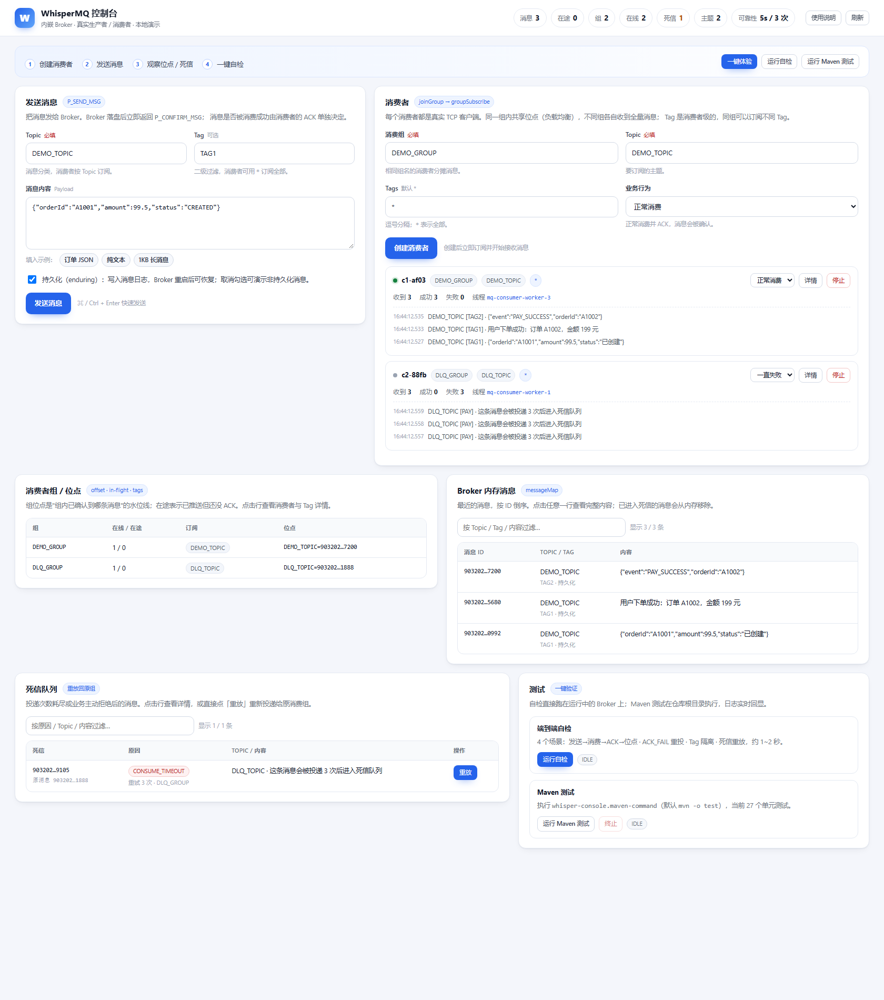

# WhisperMQ

一个用 Java 17 + Netty + Spring Boot 实现的轻量级消息队列（教学 / 本地验证用途）。
支持 topic、消费者组、消费者级 Tag、位点持久化、ACK 超时重投、死信与重放、断线重连，
并自带一个 **Web 控制台**：拉取代码后启动控制台进程，即可在浏览器里体验生产/消费全流程。

## 模块

| 模块 | 说明 |
|---|---|
| `WhisperMQ-common` | 协议 DTO、实体、配置、雪花 ID |
| `WhisperMQ-broker` | Broker：接入、路由、in-flight 重投、位点、死信 |
| `WhisperMQ-producer` | 生产者客户端（发送确认、超时重传、自动重连） |
| `WhisperMQ-consumer` | 消费者客户端（入组、订阅确认、业务线程池、ACK/拒绝） |
| `WhisperMQ-console` | Web 控制台：内嵌 Broker + REST API + 单页页面 |
| `WhisperMQ-test` | 预留的测试模块 |

## 快速开始（Web 控制台）

要求：**JDK 17+**、**Maven 3.8+**（首次构建可用 `-o` 离线参数，前提是依赖已缓存）。

```bash
# 构建并启动（会自动打包 console 及其依赖模块）
mvn -o -DskipTests package -pl WhisperMQ-console -am
java -jar WhisperMQ-console/target/WhisperMQ-console-1.0-SNAPSHOT.jar
```

或者使用脚本：

```powershell
./scripts/start-console.ps1      # Windows
./scripts/start-console.sh       # macOS / Linux
```

启动后打开 **http://127.0.0.1:8080**。
控制台进程内嵌 Broker（默认端口 `9999`），页面上创建的消费者/生产者都是**真实 TCP 客户端**，
走与外部使用完全一致的协议，不是模拟数据。



想体验分区与再均衡，可以按 2 分区启动：`java -jar ... --whisper-mq.default-partitions=2`，
然后在同一消费组创建两个消费者——它们会各自接管一个分区（控制台「消费者组」详情里能看到分配表）。

> 完整的能力边界、性能实测、适用场景与使用指南见
> [`docs/capabilities.md`](docs/capabilities.md)。

## 控制台能做什么

- **发送消息**：topic、tag、payload、是否持久化（enduring），带示例内容一键填入
- **创建消费者**：选择消费组、topic、tag（支持 `*` 与 `TAG_A,TAG_B`），并选择业务行为：
  - 正常消费 / 一直失败（ACK_FAIL）/ 首次失败（看重投）/ 拒绝并重试（死信链路）/
    抛异常（验证业务线程隔离）/ 慢消费 500ms
- **观察 Broker**：消息数、在途数、组数、在线消费者数、死信数；顶栏指标悬停可预览明细、点击跳转到对应区域
- **消费者组**：在线消费者、订阅关系、组位点、消费者级 Tag、在途消息；点击行查看详情
- **Broker 内存消息**：最近的 `messageMap` 内容，支持按 Topic / Tag / 内容过滤，点击行查看完整 payload
- **死信队列**：查看、过滤并一键**重放**回原消费组；点击行查看死信详情与原始 JSON
- **一键自检**：4 个端到端场景（发送→消费→ACK→位点、ACK_FAIL 重投、Tag 隔离、死信重放）
- **批量压测**：按条数/字节数发送并统计吞吐
- **一键 Maven 测试**：在仓库根目录执行 `mvn -o test`，日志实时回显、可终止
- 顶栏展示暂停数、存储段数；消费者卡片展示队列水位与去重命中
- 右上角「使用说明」内置概念解释、存储/背压/去重/鉴权说明与建议体验顺序

页面上的所有数据通过 `GET /api/overview` 每 2 秒轮询刷新。

## REST API

| 方法 | 路径 | 说明 |
|---|---|---|
| GET | `/api/overview` | Broker / 组 / 消费者 / 消息 / 死信快照 |
| POST | `/api/messages` | 发送消息 `{topic,tag,payload,enduring}` |
| GET | `/api/messages/{id}` | 消息详情（完整 payload；已死信的会回溯到死信队列） |
| POST | `/api/consumers` | 创建消费者 `{group,topic,tags,mode}` |
| DELETE | `/api/consumers/{id}` | 停止消费者 |
| PATCH | `/api/consumers/{id}/mode` | 切换业务行为 `{mode}` |
| GET | `/api/deadletters` | 死信列表 |
| GET | `/api/deadletters/{id}` | 死信详情（完整 payload + 原始 JSON） |
| POST | `/api/deadletters/{id}/replay` | 重放死信 |
| POST/GET | `/api/test/self` | 启动 / 查询自检 |
| POST/GET | `/api/test/maven` | 启动 / 查询 Maven 测试 |
| POST | `/api/test/maven/cancel` | 终止 Maven 测试 |

## 性能（本机实测）

2000 条 256B 持久化消息、单机单分区、同步发送：

| 指标 | 结果 |
|---|---|
| 生产者吞吐 | ≈ 2 540 条/秒 |
| `send` P50 / P99 | 0.354 ms / 0.960 ms |
| 端到端消费吞吐 | ≈ 2 539 条/秒 |
| 批量发送（100 条/批） | ≈ 10 345 条/秒（约 7× 单条） |

复现：`mvn -o -pl WhisperMQ-consumer -am test -Dtest=BenchmarkIT -DfailIfNoTests=false`。
默认 ASYNC（页缓存）；`INTERVAL` 约 2 300 条/秒，`SYNC` 约 138 条/秒（本机 fsync 约 7ms），
可按“断电丢失窗口 vs 吞吐”选择；详见能力文档。

## 测试

```bash
# 单元测试（60 个）
mvn -o test

# 端到端集成测试（12 个场景，自己拉起一个 Broker，监听 19999）
mvn -o -pl WhisperMQ-consumer -am test -Dtest=SmokeIT -DfailIfNoTests=false
```

## 配置

- `whisper-mq.*`：Broker / 客户端 / 可靠性参数，见 `MqConfigProperties`
  （`ack-timeout-millis`、`max-delivery-attempts`、`max-dead-letter-retry-count`、
  `heartbeat-interval-millis`、`reconnect-*-millis`、`subscribe-timeout-millis`、
  `default-partitions`、`hot-cache-size`、`retention-millis`、`retention-max-bytes`、
  `max-file-size`、`flush-mode`、`store-flush-interval-millis`、`shutdown-drain-millis`、
  `backpressure-*`、`dedup-*`、`auth-*` 等）。
- `whisper-console.*`：控制台参数，见 `WhisperMQ-console/src/main/resources/application.properties`
  （`maven-command`、`repo-root`、`max-recent-messages`）。
- 控制台默认数据目录为 `./WhisperMQ-console-data`，与仓库根目录的历史演示数据隔离。

## 参数调优（按场景，默认值不变）

| 目标 | 配置 | 建议 |
|---|---|---|
| 吞吐优先 | `flush-mode=ASYNC` | 默认；断电可能丢最近消息 |
| 平衡 | `flush-mode=INTERVAL` + `store-flush-interval-millis=1000` | 最多丢一个 force 间隔，吞吐几乎不变 |
| 不丢已确认 | `flush-mode=SYNC` | 本机约 138 msg/s；吞吐敏感场景需配批量发送 |
| 大批量写入 | `max-batch-size=1000` + `sendBatch()` | 100 条/批实测约 10k msg/s |
| 容量控制 | `hot-cache-size`、`retention-millis`、`retention-max-bytes` | 大堆积时降低热缓存、开启保留 |
| 消费过载 | `consumer-queue-capacity`、`backpressure-*` | 队列满会暂停投递，回落后补投 |
| 重复消费 | `dedup-enabled`、`dedup-cache-size` | 默认开启，1000 条 LRU |
| 内网安全 | `auth-enabled=true` + `auth-token` | 默认关闭；TLS 未实现 |

## P1 升级路线

详见 [`docs/p1-roadmap.md`](docs/p1-roadmap.md)。

- **Stage A（已完成）**：协议版本号、分区/位点数据模型（默认 1 分区，行为不变）、
  清理与历史测试迁移、消费端指标暴露；
- **Stage B（已完成）**：分区投递与再均衡（`(topic, partition) → consumer` 分配表、
  epoch、按分区位点推进、Tag × 分区回退规则）；
- **Stage C（已完成）**：Segment 存储 + 索引、启动按需加载、TTL/容量保留；
- **Stage D（已完成，TLS 待做）**：暂停投递背压、消费端去重、Token 鉴权、
  `/api/stats` 指标；TLS 留待后续；
- **Stage E**：多 Broker 副本、选主与故障转移。

## 已知限制 / 后续计划

- 分区投递已可用：`whisper-mq.default-partitions=N`（N>1）即按分区分配给消费者；
  默认仍为 1，行为与升级前一致；
- 再均衡采用“排序后轮询”，消费者上下线会导致部分分区换 owner，期间不暂停投递；
  消费者数多于分区数时，多余消费者暂时空闲；
- 同组 Tag 不一致时，分区 owner 与 Tag 冲突会回退到其它消费者，该分区的严格顺序被放宽；
- 多 Broker 副本、选主尚未实现；
- 位点已按分区维护，跨分区不再互相覆盖；同一分区内仍按消息 ID 水位推进；
- 存储已分段并建索引：启动只加载索引，消息体按需读取，`messageMap` 只是热缓存；
  索引仍常驻内存，百万级消息需要后续的磁盘索引/分页；
- 保留策略按整段删除（TTL / 容量），默认关闭，需显式配置；
- Token 鉴权已支持（默认关闭）；TLS 尚未实现，仍是明文 TCP；
- 去重是消费端进程内 LRU（默认开启，1000 条），重启失效、跨实例不共享；
- 业务线程池满时仍采用“不 ACK + Broker 超时重投”，Stage D 改为暂停投递。

详见 `docs/` 下的架构图与 P1 路线图。

